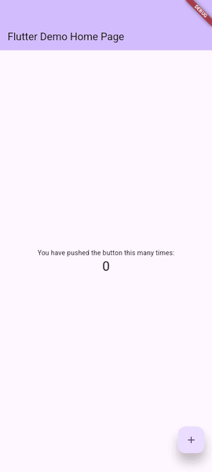

<p align="center"></p>

<h1 align="center">jewelry</h1>

<p align="center">Video goldens for Flutter integration tests.</p>

Write a scenario as plain Dart steps. jewelry boots a clean emulator, runs the
scenario, captures every engine frame, and compares the result frame by frame
against a recorded golden. Mismatches are reported like widget goldens: expected,
actual, diff, plus the step and frame where it went wrong.

Two packages, one repo:

- `packages/jewelry`: the core. Scenario DSL, actions, frame capture, comparator, report, CLI. Firebase-agnostic.
- `packages/jewelry_firebase`: runs the app against the Firebase Emulator Suite (the CLI owns the emulators) and seeds through the app's own plugin instances, via an extension on the scenario context.
- `example/`: a small app with scenarios that double as the packages' own end-to-end tests.

## How a scenario looks

This is `example/integration_test/scenarios/notes_test.dart`, next to the golden it recorded on a Pixel 8 Pro emulator:



```dart
void main() {
  JewelryBinding.ensureInitialized();

  scenario(
    'User logs in and sees their notes',
    launch: (ctx) => ctx.tester.pumpWidget(const NotesApp()),
    steps: [
      logInAs('anna@example.com', 'secret'),
      step('Open the notes list', (t) async {
        await t.tap('notesTab');
        await t.waitFor('notesList');
        await t.expectText('Groceries');
      }),
    ],
  );
}

// integration_test/steps/auth_steps.dart
Step logInAs(String email, String password) =>
    step('Log in as $email', (t) async {
      await t.enterText('emailField', email);
      await t.enterText('passwordField', password);
      await t.tap('loginButton');
      await t.waitFor('home');
    });
```

<br clear="right">

Strings like `'notesTab'` are widget keys. The next run replays the same steps and compares all 210 frames against this recording.

## The loop

```
dart run jewelry run --record      # on a known-good branch: record goldens
dart run jewelry run               # on your branch: compare
dart run jewelry run --failed      # only what failed last time
dart run jewelry accept            # the last run is right: make its recordings the goldens
dart run jewelry video full_screen_alarm   # the golden as an MP4 to share (needs ffmpeg)
dart run jewelry devices           # list AVDs and simulators matching jewelry.yaml
```

While it runs, a footer shows:

- a progress bar with passed and failed counts
- the elapsed time next to what the same files took last time
- the scenario and step it is on

Each finished scenario gets one line. The run ends with a summary that lists every failure with its reason, evidence folder, log and the command to rerun it.

`--verbose` prints the raw `flutter test` output instead. It is kept in `.jewelry/logs/` either way. Android emulators run headless unless you pass `--window`. A simulator never opens a window.

`.jewelry/report.html` is the same result to look at: per failure the golden frame next to the run's frame with the differing pixels in red, every snapshot that changed, the frames per step of both, and both recordings to play. It is rewritten after every scenario, so it is there when a run is stopped halfway.

`jewelry accept` runs nothing. A failed comparison leaves its complete recording in `.jewelry/failures/`, and accept copies that over the golden, snapshots included. `jewelry accept "Diary note"` takes one scenario. A scenario whose step failed is refused: that run stopped halfway.

`jewelry run` serves a live dashboard at http://localhost:4848/ while it runs: every scenario with its state on the left, every emulator's screen with the scenario's steps (done, now, still to come) on the right. Click a scenario for its golden as a video, or a failure's recording, reason and difference images. `--no-dashboard` turns it off, `--dashboard-port` moves it.

`jewelry video <scenario>` writes `.jewelry/videos/<scenario>.<profile>.mp4`: an H.264 video of the golden, a few hundred kilobytes where the APNG is tens of megabytes, that plays in Slack or a browser. The name is a folder under `.jewelry/goldens`, or a unique part of one. App frames keep their 60 Hz timing; phone frames (lock screen, home screen), taken about once a second while the scenario waited, show for a tenth of a second each.

### Defaults in `jewelry.yaml`

The first `jewelry run` in an app without a `jewelry.yaml` writes one, with a profile for the first AVD on the machine, and stops so you can check it. What `run` does without flags comes from that file:

```yaml
default_profile: pixel_8_pro_api_35   # --profile <name> picks another; without the key, every profile
headless: true                        # --window shows the emulator
parallel: 5                           # emulators at once, --parallel <n>
```

With `parallel` above 1, that many read-only instances of the AVD boot, each with its own Firebase emulators on its own ports, and they share the queue of scenario files. Every emulator takes its own RAM (`ram_mb`), so the number is a property of the machine. The app is still built one scenario at a time, because all emulators build into the same project folder. Android only; simulators run one at a time.

### Frames or screens

`match: frames` (the default) compares every frame in order. It fits an app whose frames are the same every run.

`match: screens` in `jewelry.yaml` compares the screens a run rests on: every picture that stays for `rest` frames (15, a quarter of a second) must show up in the other recording, in order, both ways. A changed text, a missing dialog or an extra screen fails. A screen that stays longer or shorter does not, and neither does data that lands a few frames earlier in an animation. Use it for an app with wall-clock timers and network. It does not compare animation frames or how long a screen rests.

Goldens and failures live in a gitignored `.jewelry/` folder in the app repo. They are local, per developer, and never committed. There is no CI mode.

To open the `.apng` recordings in VS Code's image preview, add this to your settings file:

```json
"workbench.editorAssociations": { "*.apng": "imagePreview.previewEditor" }
```

## Development

Flutter is pinned with fvm (`.fvmrc`). Always use `fvm flutter`.

```
fvm flutter pub get
```
